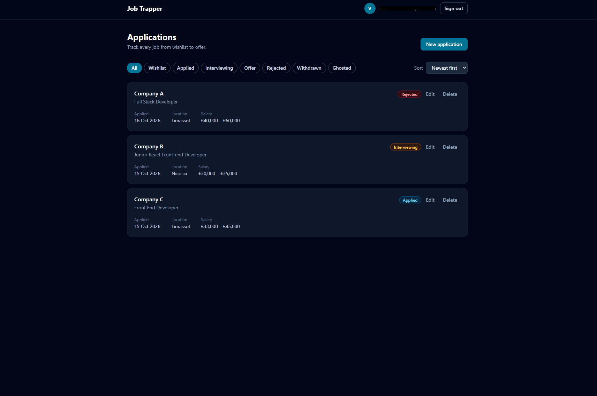
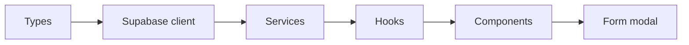

# Job Trapper

A personal job application tracker. Log every application, move it through a status pipeline from wishlist to offer, and see where each one stands.

Built as a learning project with a deliberately strict, layered frontend architecture on a React + Supabase stack.

**Live demo: [jobtrapper.netlify.app](https://jobtrapper.netlify.app)**



> **Status:** core features are complete and deployed. Version 2 features are next.

## Features

- **Accounts**: sign up and sign in with email and password, or with Google.
- **Applications**: create, edit and delete applications with company, role, status, applied date, job URL, location, salary range (EUR) and notes.
- **Status pipeline**: Wishlist → Applied → Interviewing → Offer, or Rejected, Withdrawn or Ghosted.
- **Status history**: every status change is recorded automatically by the database, ready for a per-application timeline.
- **Filtering and sorting**: filter by status and sort by applied date. Both are kept in the URL, so they survive a refresh and work with the back button.
- **Validation**: required fields, valid URLs, whole-euro salaries, and a minimum salary that can't exceed the maximum.
- **Private by default**: each user only ever sees their own applications, enforced by the database.

## Tech stack

| Area                 | Choice                                                                                                               |
| -------------------- | -------------------------------------------------------------------------------------------------------------------- |
| Build and dev server | [Vite](https://vite.dev) 8                                                                                           |
| UI                   | [React](https://react.dev) 19, [TypeScript](https://www.typescriptlang.org) (strict)                                 |
| Styling              | [Tailwind CSS](https://tailwindcss.com) 4                                                                            |
| Backend              | [Supabase](https://supabase.com): Postgres, Auth, Row Level Security                                                 |
| Server state         | [TanStack Query](https://tanstack.com/query) 5                                                                       |
| Routing              | [React Router](https://reactrouter.com) 8                                                                            |
| Forms and validation | [react-hook-form](https://react-hook-form.com) + [Zod](https://zod.dev) 4                                            |
| Testing              | [Vitest](https://vitest.dev) + [React Testing Library](https://testing-library.com/docs/react-testing-library/intro) |
| Hosting              | [Netlify](https://www.netlify.com)                                                                                   |

## Architecture

The frontend is split into layers. Each layer only imports from the layer below it, so components never talk to the database directly.



| Layer           | Folder                          | Responsibility                                                                                       |
| --------------- | ------------------------------- | ---------------------------------------------------------------------------------------------------- |
| Types           | `src/types/`                    | Database types generated from the schema, plus camelCase domain types                                |
| Supabase client | `src/lib/supabase.ts`           | The single client instance                                                                           |
| Services        | `src/services/`                 | The only code that calls Supabase; maps database rows (`applied_at`) to domain objects (`appliedAt`) |
| Hooks           | `src/hooks/`                    | Wrap services in TanStack Query: caching, loading and error state, refetching after changes          |
| Components      | `src/components/`, `src/pages/` | UI only; receive data through props or hooks                                                         |

### Key decisions

- **Security lives in the database.** Every table has Row Level Security policies (`user_id = auth.uid()`). Frontend checks such as the protected route are for user experience only.
- **History is recorded by a trigger.** A Postgres trigger writes to `application_events` whenever an application's status changes, so the frontend can't forget or fake it.
- **Server state and client state are kept apart.** Data from Supabase lives in TanStack Query. UI state, such as which modal is open, lives in components. React Context is used only for the auth session.
- **The Zod schema is the source of the form's types.** Form input and output types are derived from it, and its output type matches the domain type exactly.
- **Filter and sort live in the URL**, not in component state, so a filtered view can be refreshed and bookmarked.
- **Schema changes are versioned migrations** in `supabase/migrations/`, never manual dashboard edits.

## Data model

Two tables in Postgres:

- **`applications`**: the current state of each application, owned by a user.
- **`application_events`**: one row per status change (`from_status` → `to_status`), written by a trigger and deleted with its application.

Statuses are a Postgres enum: `wishlist`, `applied`, `interviewing`, `offer`, `rejected`, `withdrawn`, `ghosted`. Salaries are stored as whole euros.

## Getting started

### Prerequisites

- [Node.js](https://nodejs.org) 20 or later
- A [Supabase](https://supabase.com) project

### 1. Install

```bash
git clone git@github.com:Vasilisap/job-tracker.git
cd job-tracker
npm install
```

### 2. Environment variables

Create `.env.local` in the project root. It's ignored by git.

```bash
VITE_SUPABASE_URL=https://<your-project-ref>.supabase.co
VITE_SUPABASE_PUBLISHABLE_KEY=<your-publishable-key>
```

Both values are under **Project Settings → API** in the Supabase dashboard.

### 3. Database

Link the project and apply the migrations:

```bash
npx supabase login
npx supabase link --project-ref <your-project-ref>
npx supabase db push
npm run update-types
```

### 4. Authentication

In the Supabase dashboard, under **Authentication → URL Configuration**, add `http://localhost:5173` as the Site URL and as a redirect URL.

Google sign-in is optional. To enable it, create an OAuth client in Google Cloud with `https://<your-project-ref>.supabase.co/auth/v1/callback` as its redirect URI, then add the client ID and secret under **Authentication → Providers → Google**.

### 5. Run

```bash
npm run dev
```

The app runs at [http://localhost:5173](http://localhost:5173).

## Scripts

| Command                | What it does                                                      |
| ---------------------- | ----------------------------------------------------------------- |
| `npm run dev`          | Start the development server                                      |
| `npm run build`        | Type-check and build for production                               |
| `npm run preview`      | Serve the production build locally                                |
| `npm test`             | Run the tests in watch mode (`npx vitest run` for a single run)   |
| `npm run lint`         | Lint the project with ESLint                                      |
| `npm run update-types` | Regenerate `src/types/database.types.ts` from the linked database |

## Testing

Each layer is tested on its own, with the layer below it replaced by a fake:

- **Services**: the row-to-domain mappers, with the Supabase client mocked
- **Hooks**: success, error and cache invalidation, with the service mocked
- **Components**: the protected route's three auth states, the status badge, and the application card's content and buttons
- **Pure logic**: the form schema, URL parsing, filtering and sorting (including that the cached list is never mutated), and formatting

## Project structure

```
src/
  components/   UI components and their tests
  context/      Auth context and provider
  hooks/        TanStack Query and auth hooks
  lib/          Supabase client, schema, filters, formatting
  pages/        Login and dashboard
  services/     Supabase access (auth and applications)
  types/        Generated database types and domain types
supabase/
  migrations/   Versioned SQL: tables, enum, RLS policies, triggers
```

## Roadmap

- [x] Deploy to Netlify
- [ ] Status timeline for each application, from the events table
- [ ] Contacts and interview rounds
- [ ] Kanban board with drag and drop between statuses
- [ ] Stats, such as response rate and time to first reply
- [ ] Light and dark theme toggle
